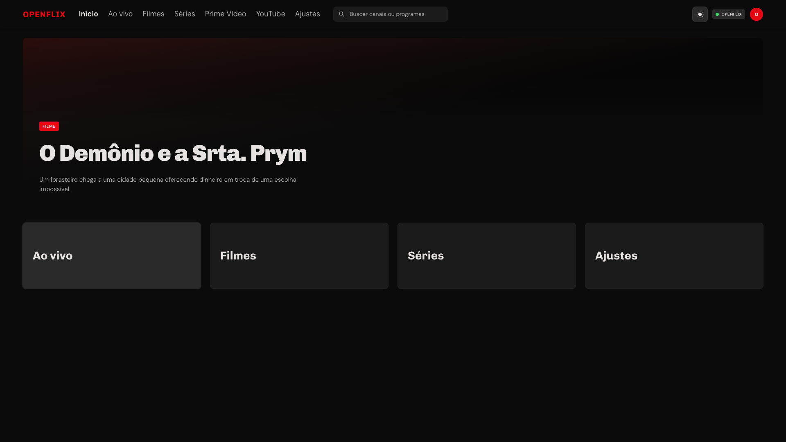

# OpenFlix

10-foot Tauri player for **your own** Xtream Codes (`player_api`) and M3U
playlists, with Prime Video and YouTube in the same shell. Architecture taken
from the LIFE TV / FlexTV LiveStore APK. No VPN, MAC cloud, insecure TLS, or
third-party IPTV catalog.

Target: landscape 1920x1080 (Dell). UI is Portuguese (pt-BR). The JS domain is
testable without the window.



Header: **Início · Ao vivo · Filmes · Séries · Prime Video · YouTube · Ajustes**.
Arrows, Enter, Esc, or click. Light/dark from the header button. Local demo
catalog needs no network.

```bash
npm ci --include=dev
npm test            # node --test + @faker-js/faker
npm run css         # Tailwind CLI → web/style.css
npm run ci          # css + prettier + lint + test
npm run dev         # css + http://127.0.0.1:8792/web/
npm run tauri:dist  # pack web/ + src/ into .tauri-dist
npm run tauri:dev   # Tauri 2 window at 1920x1080
npm run tauri:app   # package target-app/OpenFlix.app (release + ad-hoc codesign)
cargo test --manifest-path src-tauri/Cargo.toml --bins
```

Repo: https://github.com/puppe1990/openflix

## What it does

### Your playlists (Xtream / M3U)

- Login with portal, username, and password (`user_info` / `server_info`)
- Live, movies, and series from `get.php` / `player_api.php` / `live|movie|series`
- Own M3U URL as a playlist (the original app's add-playlist MAC stays out)
- Live listing: categories on the left, channels on the right, Cards/Lista,
  synthetic **Todos**, xmltv now/next
- Home rows for continue watching and favorites; resume, favorite, and lock
- HLS in the Tauri webview (hls.js + shell fetch); progressive MP4 in `<video>`
- Sidecar IINA/`mpv` for MKV/TS and as an escape hatch

### Player

- Cinema HUD over the frame (play, red bar, ±10s on VOD, volume, speed,
  fullscreen)
- HLS quality menu when the master has more than one `STREAM-INF`
- Picture-in-picture when you leave a playing video
- Seek to live on live channels

### Prime Video

- Native 10-foot catalog from the official storefront
  (`GET /api/enrichNav`, `POST /api/getLandingPage`)
- Sign in through the official Amazon window; session stays in the vault
- Native player on macOS: the official pane mints the PRS session and the
  OpenFlix HUD plays the HLS with the legacy `WebKitMediaKeys` FairPlay path
- VOD and live/linear share the same captured official session (PRS + license);
  live skips resume and shows the **Ao vivo** badge
- Any failure falls back to the official Amazon child webview inside the
  OpenFlix window

### YouTube

- Native 10-foot catalog via Innertube WEB (home, subscriptions, history,
  library, search)
- Sign in through the in-app Google/YouTube window
- VOD and live play in the OpenFlix player through a localhost Range/HLS proxy
- Personal session, not a third-party catalog

On the Tauri app, playlists, favorites, resume, history, live catalog cache, and
EPG live in `life-tv.sqlite` (mode 0600) in the app data directory. Xtream
passwords and Prime/YouTube cookies stay in the `secrets.json` vault.

## Download

Binaries for macOS (Apple Silicon and Intel), Windows, and Linux are on
[GitHub Releases](https://github.com/puppe1990/openflix/releases). A push of a
`v*` tag runs `.github/workflows/release.yml` (Tauri bundle). Local macOS ad-hoc
build stays `npm run tauri:app` → `target-app/OpenFlix.app`.

## Docs

- Reverse-engineering notes for the reference APK (protocol, obfuscation,
  endpoints): [docs/reverse-engineering.md](docs/reverse-engineering.md)
- Official Prime Video web endpoints (storefront, PRS/PES, DRM, CDN):
  [docs/prime-video-endpoints.md](docs/prime-video-endpoints.md)
- Innertube YouTube (WEB catalog, ANDROID/IOS/WEB `/player`, Range/HLS proxy):
  [docs/youtube-innertube-endpoints.md](docs/youtube-innertube-endpoints.md)

## In scope

- Xtream login (`user_info` / `server_info`)
- Portal → `get.php` / `player_api.php` / `live|movie|series`
- Local XC or M3U playlist
- Catalog by category, M3U parse, adaptive MIME, resume, favorite, and lock
- Official Prime Video catalog + native player (official Amazon pane session,
  VOD and live) with the official pane as fallback
- Official YouTube catalog + playback through the local media proxy

## Out of scope

- MAC phone-home, `libhax` / VPN, key dumps, streams that are not from the
  user's playlist
- Reusing art from the reference APK in the icon or the header
- Cloning Widevine/FairPlay or Amazon playback envelopes (the native player
  reuses the session the official pane mints; it never forges one)
- YouTube Music WEB_REMIX (that's [OurTube Music](https://github.com/puppe1990/ourtube-music))
